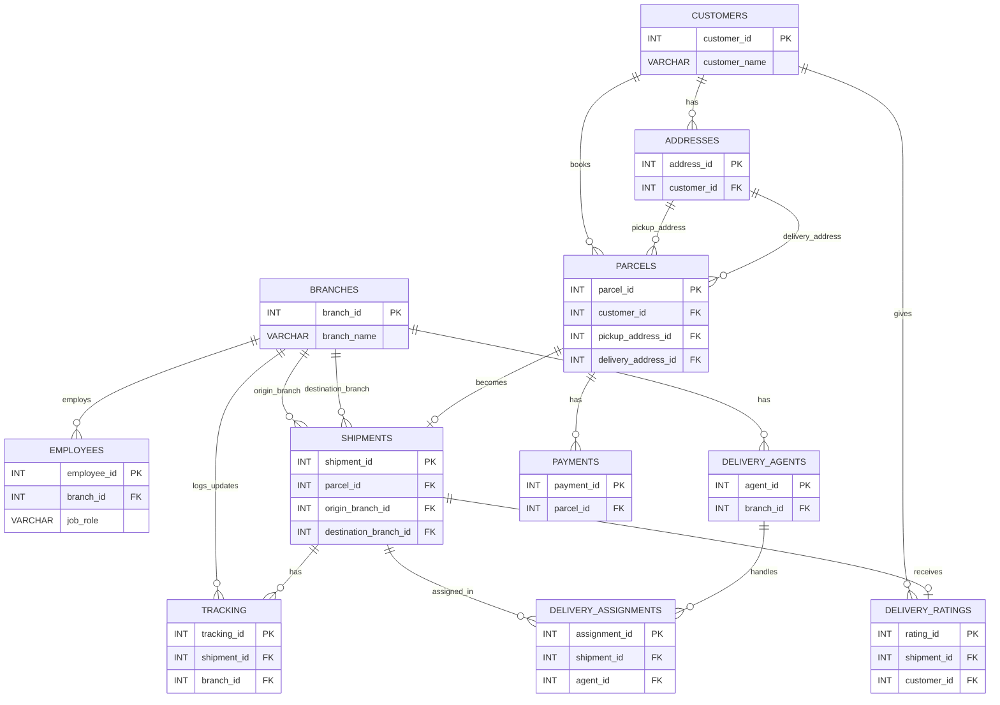

# Courier & Parcel Delivery Management Database

An individual academic project built with **MySQL** and **MySQL Workbench** to model courier operations, from parcel bookings through shipment tracking, delivery assignments, payments, and customer feedback.

> **Project scope:** This is a relational database and SQL demonstration project, not a deployed courier-tracking website or an integration with a real courier company. Records are for educational demonstration.

## Overview

The database connects customers and their addresses with parcels, shipments, shipment-tracking updates, delivery agents, payments, and delivery feedback. Branch and employee tables model the operational side of the business.

## Technologies

- MySQL and MySQL Workbench
- SQL: relational schema design, DDL, DML, joins, aggregation, subqueries, views, transactions, triggers, and stored procedures

## Database structure

The database contains **11 tables**:

| Table | Purpose |
| --- | --- |
| `customers` | Stores individual and business customers |
| `addresses` | Stores customer pickup and delivery addresses |
| `branches` | Represents courier hubs and branches |
| `employees` | Stores branch employee details |
| `parcels` | Records bookings and parcel details |
| `shipments` | Tracks shipments and their statuses |
| `tracking` | Records shipment movement and status updates |
| `delivery_agents` | Stores delivery personnel |
| `delivery_assignments` | Connects shipments to delivery agents |
| `payments` | Records parcel payments and payment statuses |
| `delivery_ratings` | Stores delivery feedback and ratings |

## Entity relationship diagram

The diagram highlights the principal table relationships; it omits most columns for readability.

## SQL concepts demonstrated

- Primary keys, foreign keys, and other constraints
- `INSERT`, `UPDATE`, `DELETE`, filtering, and sorting
- `INNER JOIN`, `LEFT JOIN`, and self-joins
- Aggregate functions, `GROUP BY`, and `HAVING`
- Nested and correlated subqueries
- Views for shipment and customer-address details
- Transactions with `COMMIT`, `ROLLBACK`, and `SAVEPOINT`
- A trigger for defaulting missing payment status
- Stored procedures for shipment details and counts by status

## Repository files

- [`database.sql`](database.sql) — Creates and populates the relational database, including sample data.
- [`examples.sql`](examples.sql) — Demonstrates SQL queries and selected database features. Run examples selectively and review operations that modify data or objects.

## How to run

1. Install **MySQL Server** and open **MySQL Workbench**.
2. Open `database.sql` in Workbench. The script targets the `FedExProject` schema; use a fresh schema or change the schema name if it already exists.
3. Execute the entire setup file. If MySQL Workbench reports **Error 1175 (safe update mode)**, review the UPDATE statements and run the script in a session with safe updates temporarily disabled (`SET SQL_SAFE_UPDATES = 0;`), restoring your previous setting afterward.
4. Verify that the tables exist with `SHOW TABLES;` and inspect records with a sample `SELECT` query.
5. Open `examples.sql` and run the relevant examples separately. These are demonstrations, not all necessary for initial setup.

**Validation:** The database setup was run in a separate test schema using MySQL Workbench after addressing a safe-update restriction. The full examples script has not been independently tested end to end.

## Project ownership

Individual academic database project.

## Disclaimer

This is an educational courier/logistics project, not affiliated with FedEx or any other delivery company. All sample records are for demonstration purposes.
